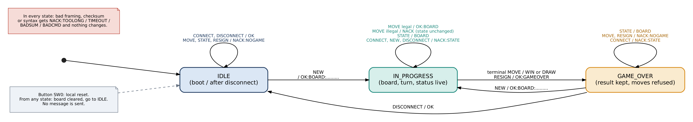
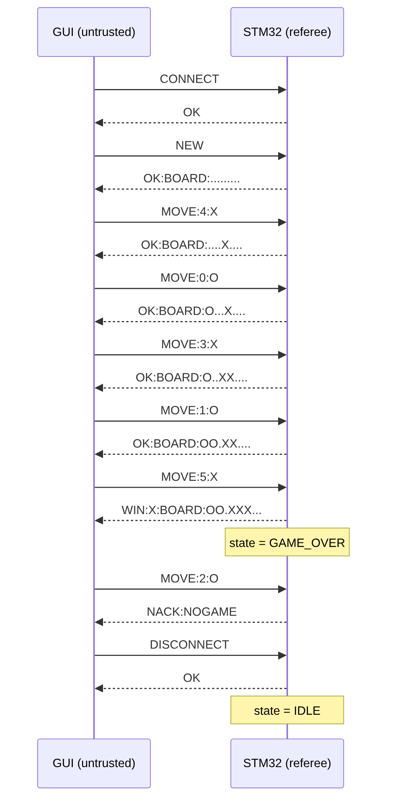
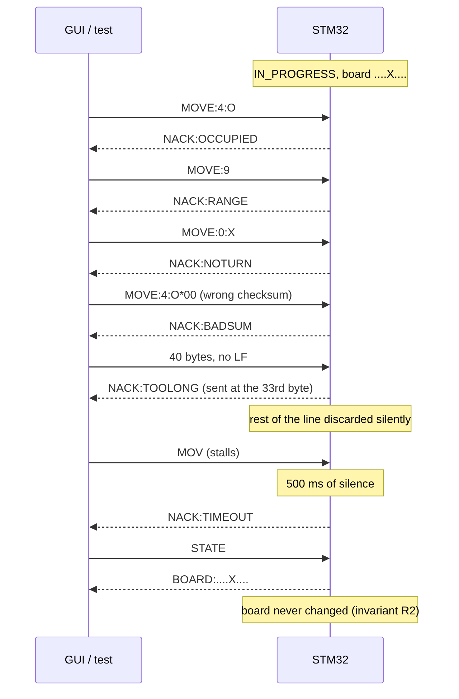
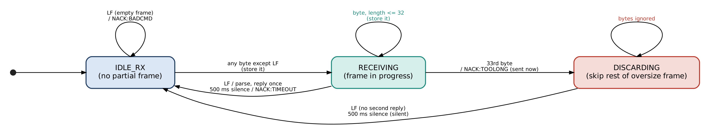

# Message protocol - v1.0 FROZEN (12 Oct 2026)

Single source of truth for the wire protocol. **Frozen:** change it only by
agreement, in the same commit as the code and the tests, and record the change in
section 14. Design reasons live in `decisions.md` (D-010, D-011, D-013).

Status: **v1.0 FROZEN.** The six choices in section 12 were reviewed and accepted
on 12 Oct 2026.

---

## 1. Overview

- Game: Tic-Tac-Toe. The STM32 is the referee and the only holder of game state.
  The PC client is untrusted: it sends requests and draws what the server confirms.
- Link: USART1 through the on-board ST-Link virtual COM port, **115200 baud, 8N1,
  no flow control** (baud to confirm on the bench).
- Text protocol: ASCII lines, one request -> exactly one reply (rules in section 3).
- The server never sends anything unless it is replying to a frame (no unsolicited
  messages in the core protocol).

## 2. Framing

A **frame** is:

```
frame    = body [ "*" hh ] LF
body     = printable ASCII bytes (0x20-0x7E), none of them "*"   (whole frame <= 32 bytes)
hh       = two UPPERCASE hex digits = XOR of every byte of body
LF       = 0x0A
```

- **Terminator:** LF. A CR (0x0D) immediately before the LF is dropped, so a
  terminal that sends CRLF works. The server always sends a bare LF.
- **Maximum frame length: 32 bytes**, counting everything before the LF
  (body + `*hh`). The longest legitimate message is 24 bytes
  (`WIN:X:BOARD:OO.XXX...*30`).
- **Checksum:** XOR of all body bytes, written as two uppercase hex digits after `*`.
  - Server -> client: **always present.** The client rejects a reply whose
    checksum is missing or wrong (see 8.4).
  - Client -> server: **optional but verified when present.** If a frame contains
    `*` it must be exactly one `*` followed by exactly two hex digits at the end,
    and the digits must match. Our GUI and tests always send it; a person typing
    into a terminal can leave it off.
  - XOR catches any single corrupted byte. It misses swapped bytes and pairs of
    errors that cancel. That is acceptable for a short cable link; we state the
    limit in the report (decision D-010).
- **Case and spaces:** commands are upper case and case-sensitive. No spaces.
- **Board encoding:** 9 characters, index 0..8 left-to-right, top-to-bottom:
  `.` empty, `X`, `O`.

```
 0 | 1 | 2
---+---+---
 3 | 4 | 5          "XO.XO...."  = X at 0,3  O at 1,4
---+---+---
 6 | 7 | 8
```

- **Who moves:** X always moves first. The side to move is X when the number of
  X equals the number of O, otherwise O. The client derives this from the board.

## 3. Framer behaviour (what the server does with bytes)

Rule: **every frame gets exactly one reply.** A frame ends at an LF, when it
overflows, or when it times out (below).

Three framer states:

| State | Meaning | Event | Action |
|---|---|---|---|
| IDLE | no partial frame | any byte except LF | store it, go to RECEIVING |
| IDLE | | LF | empty frame: reply `NACK:BADCMD` |
| RECEIVING | frame in progress | byte (not LF) and length < 32 | store it |
| RECEIVING | | byte (not LF) and length would exceed 32 | reply `NACK:TOOLONG` **now**, discard what was stored, go to DISCARDING |
| RECEIVING | | LF | parse the frame (section 4), reply, go to IDLE |
| RECEIVING | | no byte for **500 ms** | drop the partial frame, reply `NACK:TIMEOUT`, go to IDLE |
| DISCARDING | skipping the rest of an oversize frame | byte (not LF) | ignore it |
| DISCARDING | | LF | go to IDLE (**no** second reply: `NACK:TOOLONG` was already sent) |
| DISCARDING | | no byte for 500 ms | go to IDLE silently |

Notes:
- The 500 ms timer is an inactivity timer: it restarts on every received byte
  and runs only while a frame is in progress.
- The parser never blocks and never waits for a missing byte. Bytes arrive in an
  interrupt, go into a ring buffer, and the main loop feeds the framer.
- A byte stream with several LFs (for example random binary data) produces one
  reply per LF. Tests count them.
- After a timeout the late remainder of the frame is just a new frame and is
  rejected normally (usually `NACK:BADCMD`).

## 4. Parsing order (first failure wins)

For each completed frame, the server checks in this order and replies with the
first error found. **None of these checks reads or changes game state.**

1. Length > 32 -> `NACK:TOOLONG` (decided while receiving, section 3)
2. Empty frame, or any byte outside 0x20-0x7E -> `NACK:BADCMD`
3. Checksum field present but malformed or wrong -> `NACK:BADSUM`
4. Body is not exactly one command from section 5 with valid arguments -> `NACK:BADCMD`

Only then does the state machine see the command (section 6).

## 5. Commands and replies

Client -> server (body shown without `*hh`):

| Command | Arguments | Meaning |
|---|---|---|
| `CONNECT` | none | Handshake; confirms the server is alive and speaking this protocol |
| `NEW` | none | Start a game with an empty board |
| `MOVE:<i>` | `<i>` = `-`? 1-3 digits | Play a cell for the side to move |
| `MOVE:<i>:<m>` | `<m>` = `X` or `O` | Same, but claims to be that side (see below) |
| `STATE` | none | Ask for the current board |
| `RESIGN` | none | Forfeit the current game |
| `DISCONNECT` | none | End the session |

`MOVE` argument rules: `<i>` is parsed as a decimal number. A value outside 0..8
(including `9`, `12`, `-1`) is `NACK:RANGE`. An empty, non-numeric or more than
3-digit index, or a mark other than `X`/`O`, is `NACK:BADCMD`. `MOVE:<i>:<m>` lets
the client say which side it believes is to move; if that is not the side to
move the server answers `NACK:NOTURN`. Our GUI always sends it, which makes a
stale or out-of-sync client detectable.

Server -> client replies:

| Reply | Sent when |
|---|---|
| `OK` | `CONNECT` accepted; `DISCONNECT` accepted |
| `OK:BOARD:<9>` | `NEW` accepted, or a legal non-terminal `MOVE` |
| `WIN:<m>:BOARD:<9>` | the `MOVE` completed three in a row for `<m>` (game over) |
| `DRAW:BOARD:<9>` | the `MOVE` filled the board with no winner (game over) |
| `BOARD:<9>` | reply to `STATE` |
| `OK:GAMEOVER` | `RESIGN` accepted (game over) |
| `NACK:<code>` | request rejected; **state is unchanged** (section 7) |

## 6. State table (every cell is defined)

Server states: **IDLE** (boot, and after a game is disconnected or the button is pressed),
**IN_PROGRESS**, **GAME_OVER**.

| Command | IDLE | IN_PROGRESS | GAME_OVER |
|---|---|---|---|
| `CONNECT` | `OK` (stay) | `NACK:STATE` | `NACK:STATE` |
| `NEW` | `OK:BOARD:.........` -> IN_PROGRESS | `NACK:STATE` | `OK:BOARD:.........` -> IN_PROGRESS |
| `MOVE` | `NACK:NOGAME` | validate (section 6.1) | `NACK:NOGAME` |
| `STATE` | `NACK:NOGAME` | `BOARD:<9>` | `BOARD:<9>` |
| `RESIGN` | `NACK:NOGAME` | `OK:GAMEOVER` -> GAME_OVER | `NACK:NOGAME` |
| `DISCONNECT` | `OK` (stay) | `NACK:STATE` | `OK` -> IDLE |

Reading the table: a valid command in the wrong state gets `NACK:NOGAME` when it
needs an active game (`MOVE`, `STATE`, `RESIGN`) and `NACK:STATE` otherwise.
To leave a game that is in progress, send `RESIGN` and then `DISCONNECT`.



### 6.1 MOVE validation (IN_PROGRESS only)

Checks run in this order and **nothing is written until all have passed**:

1. Index in 0..8, else `NACK:RANGE`
2. If a mark was given, it equals the side to move, else `NACK:NOTURN`
3. Cell `<i>` is `.`, else `NACK:OCCUPIED`
4. **Commit:** write the mark into cell `<i>`. Then, on the new board:
   - three in a row for the mover (8 lines: 3 rows, 3 columns, 2 diagonals)
     -> state = GAME_OVER, reply `WIN:<m>:BOARD:<9>`
   - else no `.` left -> state = GAME_OVER, reply `DRAW:BOARD:<9>`
   - else the turn passes, reply `OK:BOARD:<9>`

If several faults are present, the first in this order is reported (for example
`MOVE:9:O` on the wrong turn is `NACK:RANGE`).

## 7. Error catalogue

Every `NACK` leaves the board, the turn and the state exactly as they were.

| Code | Meaning | Raised by |
|---|---|---|
| `NACK:TOOLONG` | frame longer than 32 bytes | framer |
| `NACK:TIMEOUT` | partial frame abandoned after 500 ms without a byte | framer |
| `NACK:BADSUM` | checksum field malformed or does not match | parser |
| `NACK:BADCMD` | empty, non-printable, unknown command, bad argument syntax | parser |
| `NACK:NOGAME` | command needs an active game and there is none | state machine |
| `NACK:STATE` | valid command, not allowed in the current state | state machine |
| `NACK:RANGE` | move index outside 0..8 | move validation |
| `NACK:NOTURN` | move claims the side that is not to move | move validation |
| `NACK:OCCUPIED` | target cell already holds a mark | move validation |

## 8. Examples

All checksums below were computed with a script, not by hand. `->` is client to
server, `<-` is server to client. Each line ends with an LF (not shown).

### 8.1 A scripted win for X (five moves)

```
-> CONNECT*5E                    <- OK*04
-> NEW*5C                        <- OK:BOARD:.........*70
-> MOVE:4:X*7D                   <- OK:BOARD:....X....*06
-> MOVE:0:O*6E                   <- OK:BOARD:O...X....*67
-> MOVE:3:X*7A                   <- OK:BOARD:O..XX....*11
-> MOVE:1:O*6F                   <- OK:BOARD:OO.XX....*70
-> MOVE:5:X*7C                   <- WIN:X:BOARD:OO.XXX...*30
-> MOVE:2:O*6C                   <- NACK:NOGAME*32           (game is over)
-> STATE*57                      <- BOARD:OO.XXX...*38
-> DISCONNECT*00                 <- OK*04
```

### 8.2 Rejected requests (board stays `....X....` after the first move)

```
-> MOVE:4:O*6A                   <- NACK:OCCUPIED*3F
-> MOVE:9*12                     <- NACK:RANGE*62
-> MOVE:0:X*79                   <- NACK:NOTURN*21      (O is to move)
-> MOVE:4X*47                    <- NACK:BADCMD*30      (bad argument syntax)
-> MOVE:4:O*00                   <- NACK:BADSUM*31      (wrong checksum)
-> STATE*57                      <- BOARD:....X....*38  (nothing changed)
```

### 8.3 A draw

```
moves (X first, alternating): 0 1 2 4 7 6 3 5 8      (X:0,2,3,7,8  O:1,4,5,6)
last reply:  DRAW:BOARD:XOXXOOOXX*02
```
No intermediate position has a winner, so every earlier reply is `OK:BOARD:...`.

### 8.4 Corrupt or missing checksum on a reply

The client treats a reply with a missing or wrong `*hh` as **not received**: it does
not redraw. If it was waiting for the reply to a `MOVE`, it sends `STATE` (safe to
repeat) and redraws from that reply.

## 9. Sequence diagrams

Checksums are left out of the diagrams to keep them readable.







Diagram sources: `docs/diagrams/` (`*.dot` Graphviz, `*.mmd` Mermaid). Re-render with `docs/diagrams/render.sh`.

## 10. Timing

- Server reply latency: well under 20 ms for every non-AI command.
- Client reply timeout: 1 s. On timeout the client sends `STATE` once; if that
  also times out it reports "server not responding" and stays disconnected.
- A 32-byte frame takes about 2.8 ms at 115200 8N1, so the 500 ms inactivity
  timeout only fires when a sender really stalls.

## 11. Hardware behaviour (not on the wire)

| Item | Behaviour |
|---|---|
| Button SW0 (PA0, active low, debounced) | Local reset: clears the board and returns the server to IDLE from any state. No message is sent. The client finds out on its next request (`MOVE` -> `NACK:NOGAME`) and returns to its start screen. |
| Status LED (PB10 red, PB11 green) | IDLE: off. IN_PROGRESS: green = X to move, red = O to move. GAME_OVER: both blink together at 2 Hz. |

Pins are from `Board.md` and are confirmed on the bench in Stage 4.

## 12. Departures and additions (reviewed, all six accepted on 12 Oct 2026)

Each one is a deliberate departure from, or addition to, the reference protocol in the brief. The report's section 2 must justify each.

1. **Terminal replies carry the board** (`WIN:X:BOARD:...`, `DRAW:BOARD:...`). The
   brief shows only `WIN:X`. Ours saves the GUI a `STATE` round trip and lets it
   redraw atomically from one valid reply.
2. **Optional `:<mark>` on `MOVE`** so that `NACK:NOTURN` is reachable and testable
   with a single client. `MOVE:<i>` alone still works as in the brief.
3. **Extra codes** `TOOLONG`, `TIMEOUT`, `BADSUM`, `STATE` beyond the brief's
   `OCCUPIED`, `RANGE`, `NOTURN`, `NOGAME`, `BADCMD`. They make framing and
   integrity failures distinguishable, which the brief asks for.
4. **Checksum optional on requests, mandatory on replies.** Keeps manual
   testing possible. Stricter option: reject unchecksummed requests.
5. **`DISCONNECT` accepted in IDLE** (the brief lists it only for GAME_OVER), so a
   client that connected but never started a game can disconnect cleanly.
6. **`STATE` in IDLE is `NACK:NOGAME`**; `NEW` while IN_PROGRESS is `NACK:STATE`
   (resign first). Button = reset to IDLE, with no unsolicited message.

Reserved for Stage 9 and **not part of the core freeze**: `NEW:AI` (play against
the server), `UNDO`, a move-clock timeout reply. Adding them updates this file in
the same commit as their code.

## 13. Invariants the tests and report rely on

- R1. Every frame (terminated, oversize, or timed out) gets exactly one reply.
- R2. A `NACK` never changes the board, turn or state.
- R3. The board changes only through an accepted `MOVE` or `NEW`; the state
  changes only through the transitions in the table in section 6 (and the button).
- R4. The server never crashes, blocks or sends partial lines, whatever bytes arrive.
- R5. After any garbage, one valid frame is answered correctly (recovery).

Required-test map (for Stage 3): `CONNECT`/`NEW` replies (8.1), legal move changes
exactly one cell (8.1), `OCCUPIED`/`RANGE` (8.2), move after game over `NOGAME`
(8.1), scripted win (8.1) and draw (8.3), plus garbage, oversize, partial-frame
timeout, and bad checksum (R1-R5).

## 14. Change log

| Version | Date | Change |
|---|---|---|
| v0.1 | 12 Oct 2026 | First complete draft |
| v1.0 | 12 Oct 2026 | Frozen. All six section-12 choices accepted unchanged |

## 15. Stretch: play against the server (`NEW:AI`) - branch `stretch-ai`, NOT part of the v1.0 freeze
Added on branch `stretch-ai`. Everything in sections 1-14 is unchanged for clients that do not send `NEW:AI`.
- `NEW:AI`: accepted in exactly the states where `NEW` is (IDLE, GAME_OVER; `NACK:STATE` in IN_PROGRESS).
  Reply `OK:BOARD:.........`. The human is X and moves first; the server plays O.
- In an AI game, after an accepted `MOVE` that does not end the game, the server chooses O's reply and
  commits it **before it replies**. The one reply to the `MOVE` shows the board after both moves
  (`OK:BOARD:<9>`, or `WIN:O:BOARD:<9>` / `DRAW:BOARD:<9>` if O's move ended the game). If the human's move
  ended the game (`WIN:X`, `DRAW`) the server does not move. Still exactly one reply per frame (R1).
- The AI move is made through the same validate-then-commit `game_move()` as any move, so it cannot be illegal.
  Strategy: minimax with alpha-beta, lowest index on ties; O never loses (X can never win an AI game).
- A plain `NEW` starts a two-player game; `RESIGN`, `DISCONNECT` and the SW0 reset end the AI mode.
- Errors are unchanged: a rejected `MOVE` never triggers an AI move. `NEW:AI` with trailing junk is `NACK:BADCMD`.
